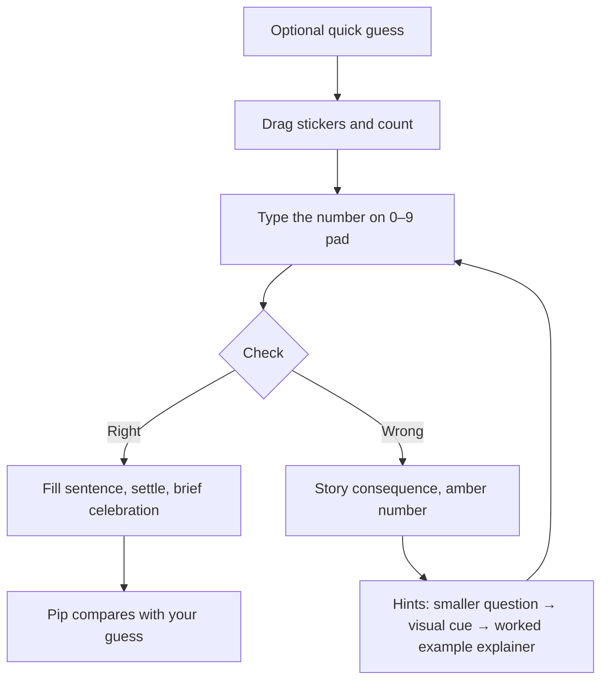

# Interaction design plan

Status: approved, Oct 30, 2026. Plain-language plan for how a child moves through one sticker story. Research backing lives in [research/mascots.md](research/mascots.md) and [research/brilliant-pedagogy.md](research/brilliant-pedagogy.md). Nothing here is built yet.

## Principles

- **Light theme only.** No dark theme.
- **Impact led.** Every screen should show the math happening, not menus or chrome.
- **No points, streaks, leagues, or loud rewards.** Progress is shown as lesson ticks (for example, 2/6 stories), not scores.
- **Calm, sparse motion.** While a question waits, only Pip’s slow blink moves (see Motion).
- **One idea per screen.** Pip asks one thing at a time.
- **Pip asks everything.** Pip (barn owl with glasses) is the fixed narrator. Pip asks every question and every hint. Story animals never speak hints or answers.
- **Actors stay out of the count.** Momo, Kiwi, and the other cast members act in the problem. They are never countable objects and never sit inside the counting area.
- **Random cast between problems only.** The same two story animals stay for one full problem and all its hints. Cast changes when the next problem starts.

## One story, step by step

1. **Optional quick guess.** More / Same / Fewer, or A few / Lots, or who has more. No score; it sets up predict-then-do-then-check.
2. **Do the story.** The story pauses. The child drags stickers from the giver’s pile or the sticker sheet onto the receiver. A live count updates as they go. Tapping the pile sends one sticker if drag is hard. The pile being counted shows **?** so the answer is never shown early. Dropping elsewhere returns the sticker.
3. **Answer.** The child types the number on a 0–9 pad (up to 20), with Undo and Check. Every tap target is at least 64 px.
4. **Check — right.** The number sentence fills in (for example, 14 − 6 = 8). Stickers settle. A brief celebration runs under 2 s. Pip compares the result with the earlier guess.
5. **Check — wrong.** The wrong number plays out as a story consequence (amber number, not “wrong”). That consequence stays in the story layer (cast and setting). Then the hint ladder runs on the same question:
   - **Rung 1 — smaller question.** A two-option Socratic question (Pip in the main flow).
   - **Rung 2 — visual cue.** Highlight, **Show me** (zoom, slow replay, ring on the pile), count-along, or a ten-frame the child fills by tapping cells.
   - **Rung 3 — worked example explainer.** A step-by-step derivation of the answer for this question: plain dots or a ten-frame, no story card, no mascots. Spec: [WORKED-EXAMPLE-EXPLAINER.md](WORKED-EXAMPLE-EXPLAINER.md).
   Hints fade and reset on each new problem.

## Lessons

Six lessons on a free-choice strip. Each shows green ticks and **x/6** progress. No points.

| Lesson | Two stories each |
|--------|------------------|
| Getting more | add-to |
| How many left? | take-from |
| Make 10 | compose to ten |
| Make it fair | equalize piles |
| Who has more? (and by how much) | compare |
| There and back | two-step give and return |

## Calm mode

A parent toggle (parent gate in the real app; exposed in the prototype for testing):

- Plain box and tray objects replace animals.
- No celebration burst.
- No Pip blink animation.

**prefers-reduced-motion:** keep state changes; drop decorative movement. Celebration off; motion uses instant or very short fades where needed.

## Motion rules

- **Properties:** transform and opacity only.
- **Easing:** `cubic-bezier(0.23, 1, 0.32, 1)`. No ease-in. No `transition: all`.
- **Waiting for input:** only Pip’s slow blink.

## What we borrow (and how we differ)

**Learn Arduino style:** instant visible effect per action; one small instruction panel; free-choice lesson strip; a second view (ten-frame) on request.

**Brilliant style:** try first; one idea per screen; instant feedback; hints that fade. We add a Socratic twist: **predict → do → check**.

**We do not borrow:** leagues, XP, streak pressure, or session-extension mechanics. See [research/brilliant-pedagogy.md](research/brilliant-pedagogy.md).

## Proposed checks (later milestones)

Not part of this doc PR; listed for the build:

- Cast lint (narrator is Pip; hero and friend from the story cast).
- Line lint (story characters never `say` hints or answers).
- BeatScript lint (no story-cast motion while input is awaited; celebrate ≤ 2000 ms).
- Playwright WebKit iPad overlap check (cast never covers input or counter).
- Animation budget check (at most one animated node within 120 px of input; transform/opacity only).

## Known gaps

- The playable prototype was tested in **Chromium only**, not Safari, a real iPad, touch hardware, or VoiceOver.
- Canvas-drawn buttons are **not accessible**. The shipping app needs native controls with proper labels.
- Concept art was **AI-generated** and may not be copyrightable (Thaler v. Perlmutter; US Copyright Office AI Part 2, Jan 2025). A person must redraw each character as original layered SVG (CC0) before release.
- **Mascots and art are not part of this PR.**
- **No study supports random rotation of story characters** between problems; that choice is design reasoning, not evidence (see [research/mascots.md](research/mascots.md)).

## Licensing

- **Code:** MIT.
- **Lesson content:** [CC BY-SA 4.0](https://creativecommons.org/licenses/by-sa/4.0/).
- **Art (once redrawn):** [CC0 1.0](https://creativecommons.org/publicdomain/zero/1.0/). Generic names only; no trademarks claimed.
